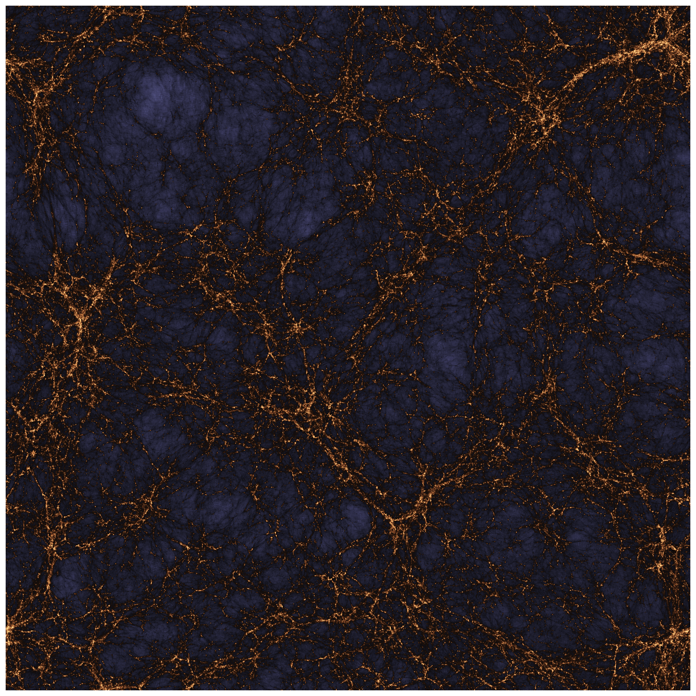

The Cosmic Web is a vast, filamentary structure woven from dark matter, forming the invisible scaffolding of the Universe. At its densest knots, galaxies are born from giant gas clouds made from neutral hydrogen. Stars are born inside these nurseries and ignite the darkness by illuminating the web from within.

In this art project neutral hydrogen is painted in bright colors on top of the underlying dark matter web. Every bright pocket in the image marks a galaxy, while darker colors beneath trace the filamentary and invisible architecture of dark matter that binds the cosmos together.

This artwork was the winning entry of the __Art from Scientific Data__ competition at the University of Zurich. All rights are reserved.